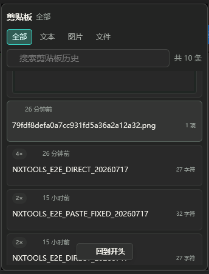
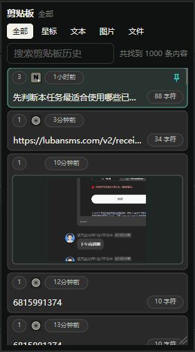
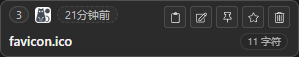

# Clipboard panel parity audit

## Audit scope

- Surface: the hotkey-invoked NxTools.Next clipboard panel.
- User goal: find a previous clip, understand its type/source/state, then paste or manage it with minimal friction.
- Comparison baseline: the previous NxTools clipboard implementation and the supplied old-panel screenshots.
- Current evidence: `01-current-panel.png`, captured at 340 × 452 pixels.

## Overall verdict

NxTools.Next currently has a working shell rather than functional parity. Capture, basic persistence, search, four type tabs, original-type paste, topmost handling, outside-hide and back-to-top exist. Most of the old product's item-management, accelerated paste, preview, category, native-format and settings workflows are absent from both the GPUI interface and the Rust/C# protocol.

This is not primarily a visual-polish problem. Several missing controls cannot be restored only in `history.rs`, because the database schema and platform protocol do not yet represent their operations.

## Evidence

### 1. Current panel — partial

Health: **partial**. The panel can be invoked, searched, filtered by type, scrolled and clicked to paste. The source-icon slot is not visibly communicating source information in this capture, and there is no visible affordance for any operation other than paste.

### 2. Previous panel browsing and preview — mature

Health: **mature baseline**. The previous panel exposed favorite/type categories, source state, pinned/favorite state and an actual image preview within a denser hierarchy.

### 3. Previous item action layer — missing in Next

Health in Next: **missing**. Hover actions conditionally provided open, edit, pin, favorite and delete. Next binds only a single left-click paste action.

### 4. Previous category management — missing in Next

Health in Next: **missing**. The previous category bar included Favorite, custom process categories, horizontal scrolling, drag reordering and add/edit/delete flows. Next hard-codes All/Text/Image/Files.

## Functional parity matrix

| Capability | Previous NxTools | NxTools.Next | Priority |
|---|---|---|---|
| Text/image/file capture and paste | Present | Present | Keep |
| True original-format paste (HTML, RTF, registered/native formats) | Present | Missing; text is normalized to Unicode text and images/files are reconstructed | P0 |
| Hover actions: open, edit, pin, favorite, delete | Present | Missing | P0 |
| Right-click action menu | Present | Missing | P0 |
| Ctrl/Alt/Shift click actions and visible mode feedback | Present and configurable | Missing | P0 |
| Copy only, plain-text/path paste, remove-line-break paste | Present | Missing | P0 |
| URL/path detection and multi-target chooser | Present | Missing | P0 |
| Large hover preview for long text and images | Present, delayed and screen-aware | Missing | P1 |
| Favorite and pinned state/order | Present | Missing from schema and UI | P0 |
| Soft delete and restore | Present | Missing from schema and UI | P1 |
| Edit text | Present | Missing from schema and UI | P1 |
| Favorite category | Present | Missing | P0 |
| Custom source-process categories | Present | Missing | P1 |
| Category add/edit/delete, drag reorder, horizontal wheel routing | Present | Missing | P1 |
| Keyboard selection: Enter and number 1–0 | Present | Missing | P1 |
| Ctrl+F and type-to-search | Present | Missing; search input is focused on open | P2 |
| Search modes: normal/wildcard/regex and case toggle | Present in the main clipboard view | Missing | P2 |
| Configurable global hotkey | Present | Fixed to Alt+C in C# | P1 |
| Placement, persisted size, preview delay and idle scroll reset | Present | Cursor placement and session resize only | P1 |
| Capture exclusions and image/file capture switches | Present | Missing | P0 for password-manager exclusion |
| Maximum history, cleanup days and protected-item cleanup | Present | Fixed 500-query limit; no retention policy | P1 |
| Storage location, archive import/export, vacuum, clear and restore | Present | Missing | P2 |
| Source process icon and tooltip | Present | Implemented in code; not visibly proven by current screenshot | Verify |
| Outside-click hide, Escape, topmost and resize | Present | Present | Keep |

## Structural findings

1. **P0 — “original paste” is not original-format paste.** The old implementation captured and restored opaque native format groups and had explicit HTML/RTF fallbacks. The current protocol only carries plain text, one PNG and file paths, and the C# adapter recreates those normalized formats. Copying rich content from a browser, Office or an IDE therefore loses fidelity.

2. **P0 — the item action model does not exist.** The GPUI row has one `on_click` path, the protocol has only paste/topmost/visibility commands, and the SQLite table has no favorite, pinned, deleted or editable metadata. Adding icons alone would create dead controls.

3. **P0 — accelerated paste behavior was dropped.** The previous implementation resolved Ctrl, Alt and Shift through a configurable activation policy and exposed the same choices in the right-click menu. Next observes only Escape and always sends the original type-specific paste command.

4. **P0 — security/privacy controls were dropped.** The old settings excluded password-manager processes by default and could disable image/file capture. Next records every supported clipboard update with no exclusion interface.

5. **P1 — preview and open-target workflows were dropped.** There is no large hover preview for long text/images, nor URL/path parsing and a chooser for multiple targets.

6. **P1 — category management was reduced to four enum values.** Favorite, process facets, custom tabs and their persistence are absent; the visual tab bar therefore cannot become feature-complete without a domain model change.

7. **P1 — settings are too shallow.** `AppConfig` currently stores only theme and pipe name. Clipboard behavior is hard-coded across Rust and C#, so changing a preference would require editing implementation rather than using a stable configuration interface.

## Accessibility risks

- Row click is the only visible action, with no inline instruction or context-menu affordance.
- Current source information appears to rely on hover only; the actual icon was not visually confirmed in the captured state.
- Keyboard users cannot move selection, activate a selected row or reach row management actions.
- Muted 9–10px metadata and narrow action targets need contrast and target-size verification after the interaction layer returns.
- Full keyboard focus order, screen-reader semantics and high-DPI reflow cannot be confirmed from screenshots alone.

## Recommended implementation order

Implement vertical slices, not a large UI-only batch:

1. **Native paste slice:** C# captures/restores an opaque native-format bundle; Rust stores it; GPUI exposes original/copy/plain/no-line-break actions; protocol and end-to-end tests prove all four outcomes.
2. **Item management slice:** Rust owns favorite/pin/soft-delete/edit state and ordering; GPUI adds hover and right-click actions; tests cover persistence and filtering.
3. **Open and preview slice:** Rust parses safe open targets, C# opens URLs/Explorer paths through Windows Shell, GPUI supplies the multi-target chooser and screen-aware preview.
4. **Category slice:** Rust owns built-in/custom category definitions and source filters; GPUI supplies scrolling, drag reorder and add/edit/delete.
5. **Settings and maintenance slice:** Rust owns settings/retention/archive interfaces; C# owns configurable hotkey and process exclusion enforcement; GPUI supplies the settings surface.

## Rust / C# / GPUI seam

- **Rust brain:** clipboard item model, SQLite schema, native-format bundle persistence, deduplication, search, flags, soft delete, category rules, activation policy, retention and archive operations.
- **C# hand:** Win32/OLE clipboard enumeration and restoration, focus/input injection, configurable global hotkey, foreground/owner resolution, excluded-process enforcement and Windows Shell open operations.
- **GPUI face:** popup rendering, hover/right-click menus, keyboard selection, modifier feedback, previews, category drag interactions and settings UI. It calls Rust interfaces and never owns persistence rules.

This keeps the modules deep: GPUI learns a small set of user-intent operations, Rust hides persistence and policy, and C# hides Windows-specific mechanics.

## Evidence limits

- The current screenshot covers one scrolled mixed-content state, not hover, context-menu, keyboard or error states.
- The application was not launched or manipulated by Codex, respecting the user's existing test-ownership request.
- Source-icon rendering and image-preview quality need a focused screenshot in an unscrolled state before visual approval.
- This audit establishes parity gaps; it does not claim WCAG compliance.
