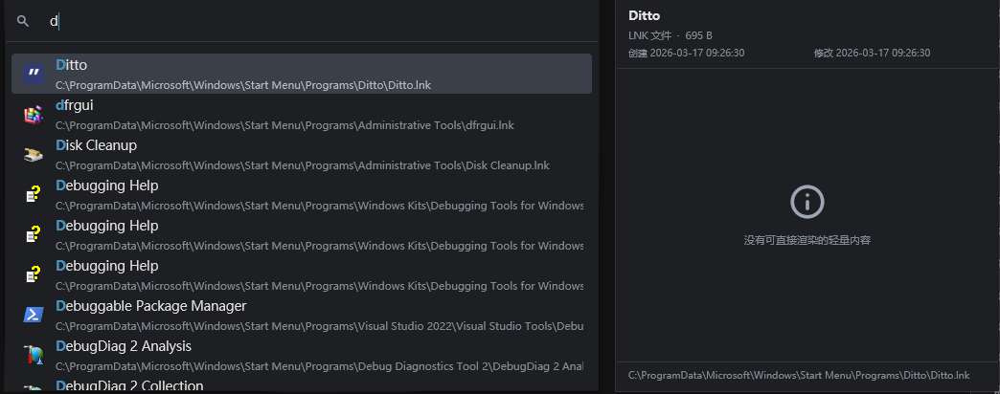
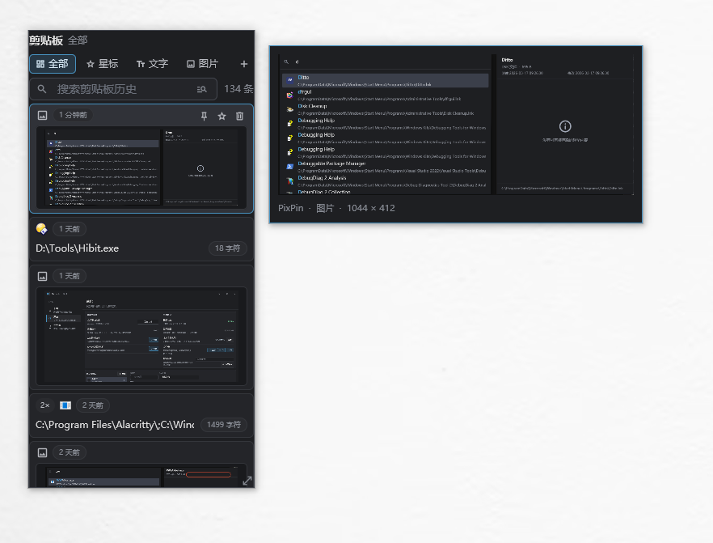

# 速启与剪贴板视觉审计

## 审计范围

- 表面：热键呼出的速启结果/预览，以及剪贴板混合历史/图片预览。
- 用户目标：在不牺牲信息量的前提下，让两个高频弹窗看起来属于同一产品，并保持紧凑、清楚、
  低干扰。
- 当前证据：用户于 2026-07-27 提供的两个运行截图；本次已保存并逐张检查。
- 参考方向：Listary 的搜索信息层级、Zed 的中性深色语义色，以及旧 NxTools 已验证的剪贴板
  功能布局。不是照抄任何一套界面。

## 总体判断

功能密度已经合理，主要问题不是“缺控件”，而是两个弹窗的视觉语法不一致。速启使用无边框列表行、
单一选中面和克制的分隔线；剪贴板同时使用卡片边框、图片内框、多个胶囊标签、强调色悬停边框和
强调色预览外框，导致相同主题下仍像两个不同程序。首轮应先统一表面、边界和文字层级，不改尺寸、
数据模型或交互链路。

## 步骤 1：速启结果与预览

健康度：**基本健康，需要细节收尾**。

### 优点

- 44 px 搜索头和 42 px 双行结果密度合适，八行视口没有大片空白。
- 选中态覆盖整行，图标、标题和路径形成稳定的三层横向节奏。
- 结果窗与预览窗顶边、底边对齐，预览使用中性边框，没有额外装饰色。

### 风险

- 预览标题、类型/大小和时间三层都偏小且色差接近，重要信息不容易快速扫读。
- 元数据型预览的中心占位信息面积很大，但标题区仍只有较弱的层级；视觉重心落在空白区。
- 结果路径和预览元数据均依赖 10–11 px 的低对比文字；截图只能确认视觉风险，不能证明不同
  DPI 下的可读性。

### 建议

- 保持搜索头、结果行和窗口尺寸不变；只增强预览标题与元数据的字号/色阶。
- 继续使用中性选中面和语义主题色，不把速启改成高饱和“科技蓝”。

## 步骤 2：剪贴板混合历史与图片预览

健康度：**功能完整，视觉层级需要统一**。

### 优点

- 面板宽度紧凑，分类、搜索、文本和图片条目都能在一屏内完成浏览。
- 图片条目按原比例自适应，当前截图没有过去固定 270 px 造成的空白。
- 条目悬停动作、图片预览和来源信息均已进入同一工作流。

### 风险

- 默认卡片边框、悬停强调边框、图片内框和预览强调边框叠加，形成过多矩形轮廓。
- 时间、复制次数和字符数都使用胶囊，视觉权重接近正文，列表扫读时噪声偏高。
- “134 条”单独占据搜索行右侧，使搜索框比分类栏短，三个水平区域没有共同右边界。
- 剪贴板预览使用强调色外框，而速启预览使用中性窗口边框，两个弹窗明显不属于同一视觉系统。
- 9 px 元数据与 20 px 悬停动作对高 DPI/触控并不友好；当前仍以鼠标键盘桌面为主要目标，
  但需要保证对比和清晰度。

### 建议

- 保留卡片高度和功能密度；默认边框透明，仅在悬停时使用中性边框，避免整屏“卡片套卡片”。
- 图片井保留深色承托面但移除第二层描边。
- 时间改为无底色的次要文本，次数和字符/项目数使用小圆角中性元素底色；总数并入可截断的
  标题摘要，让搜索框占满可用宽度。
- 剪贴板预览外框改为与速启相同的中性窗口边框。

## 首轮实现结果

- 速启预览采用 `14 / 11 / 10.5 px` 的标题、详情、时间层级；详情使用次要文本色，时间继续
  使用弱化文本色。
- 剪贴板条目默认描边透明，悬停改用中性边框；图片承托面移除内框。
- 时间不再渲染为胶囊；次数和内容数量改为 3 px 小圆角中性标签。
- 分类名与总数合并为可截断的标题摘要，避免和快捷操作/状态提示争抢 300 px 标题栏宽度。
- 剪贴板预览与速启预览使用相同的中性窗口边框。

## 首轮实现边界

1. 只修改 GPUI 视觉呈现和共享语义主题，不改 Rust 领域状态、SQLite、C# Windows 适配或协议。
2. 不改变面板尺寸、条目高度、图片自适应算法、分类拖动、悬停动作、预览生命周期和快捷键。
3. 先统一边框、表面、胶囊和预览文字层级；动画与更大布局调整留给首轮截图对比后决定。

## 证据限制

- 当前截图覆盖结果、图片历史和两个预览，但没有覆盖速启动作模式、剪贴板右键菜单、编辑弹层、
  空状态及浅色/高对比主题。
- 无法仅凭截图确认键盘焦点、屏幕阅读器语义、125%/150% DPI 和动态动画质量。
